# 哔哩下载器 · GenshinplayerDom

[](https://github.com/GenshinplayerDom/bilibili-downloader/releases/latest)
[](#下载与安装)
[](LICENSE)

B 站视频 / 音频下载器。Windows 端基于 Electron，Android 端使用原生 WebView 与下载桥，另附一份油猴脚本。当前版本 **1.8.17**。

> 本项目基于 **MIT License** 开源。请保留署名「GenshinplayerDom」，并遵循协议条款。

## 主要特性

- **五个顶层频道**：热门推荐 / 视频 / 番剧 / 电影 / **UP 主**。UP 主与番剧、电影同级，是独立频道而不是嵌在番剧里。
- **UP 主投稿**：按昵称、UID、`space.bilibili.com/…` 搜索，选中后按发布时间查看投稿；每页 50 条并显示总投稿数，可连续翻页看完整个主页。
- **番剧 / 电影独立下载页**：评分、简介、地区、风格、预告花絮一目了然；支持 4K / 真彩 HDR / 60 帧、音轨、编码、封装、线程与片段。
- **并发下载与批量入队**：设置同时下载数上限（默认 8），超限自动排队、完成后补位；番剧整季、合集、收藏夹可勾选批量下载。
- **续传与可靠性**：分片校验、备用地址重试、跨重启续传、同名自动 `(1)(2)` 保护、下载记录可打开 / 定位 / 删除文件。

## 下载与安装

最新版本：**[v1.8.17](https://github.com/GenshinplayerDom/bilibili-downloader/releases/tag/v1.8.17)** ｜ [全部发布](https://github.com/GenshinplayerDom/bilibili-downloader/releases)

| 文件 | 适用场景 | 大小 |
| --- | --- | --- |
| [BiliDownloader-1.8.17-x64-Setup.exe](https://github.com/GenshinplayerDom/bilibili-downloader/releases/download/v1.8.17/BiliDownloader-1.8.17-x64-Setup.exe) | 64 位 Windows 安装版（推荐） | 179 MB |
| [BiliDownloader-1.8.17-x64-portable.zip](https://github.com/GenshinplayerDom/bilibili-downloader/releases/download/v1.8.17/BiliDownloader-1.8.17-x64-portable.zip) | 64 位免安装便携版 | 179 MB |

- 系统要求：64 位 Windows 10 / 11。
- 安装版与便携版都内置 FFmpeg，无需额外安装；便携版解压即用，配置与下载记录写在用户目录。
- 本轮只发布 64 位包；32 位可继续用 [v1.8.8 32 位](https://github.com/GenshinplayerDom/bilibili-downloader/releases/tag/v1.8.8)。

## 界面预览

以下截图来自 **v1.8.17 实际运行界面**（1440 宽度窗口，未登录状态，内容为线上实时数据）。

### 热门推荐

点击卡片即在上方播放器播放，播放栏下方直接给清晰度、类型与预估大小，可直接下载；网格随窗口宽度自适应列数。

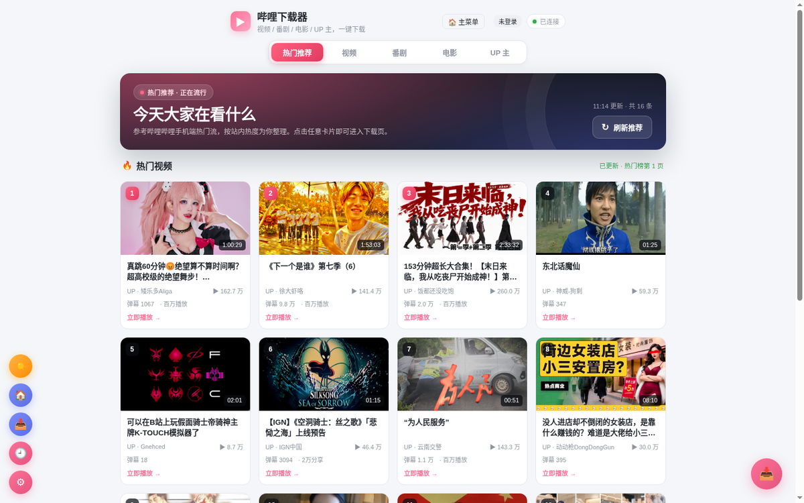

### 视频解析

粘贴链接 / BV 号 / 关键词后自动识别，展示标题、UP 主、播放与互动数据，下方是清晰度、编码、封装、线程、片段、定时、字幕弹幕等选项。

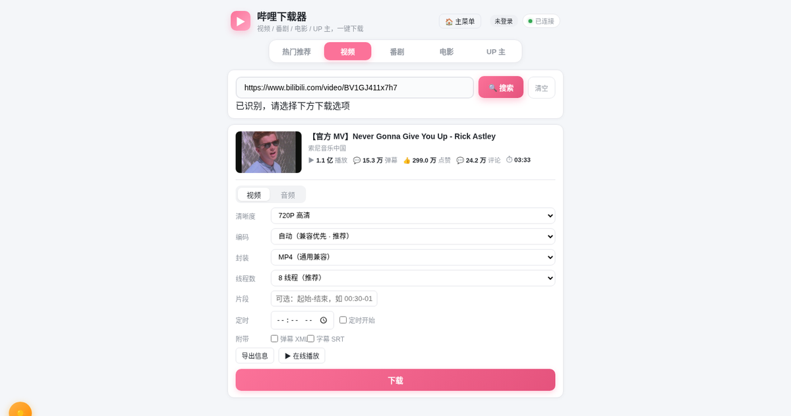

### 合集 / 收藏夹批量列表

表格列出封面、标题、播放量、弹幕与时长，支持勾选、全选 / 全不选；点「标题」进单个视频详情，点标题左侧区域只做勾选，避免误入详情。

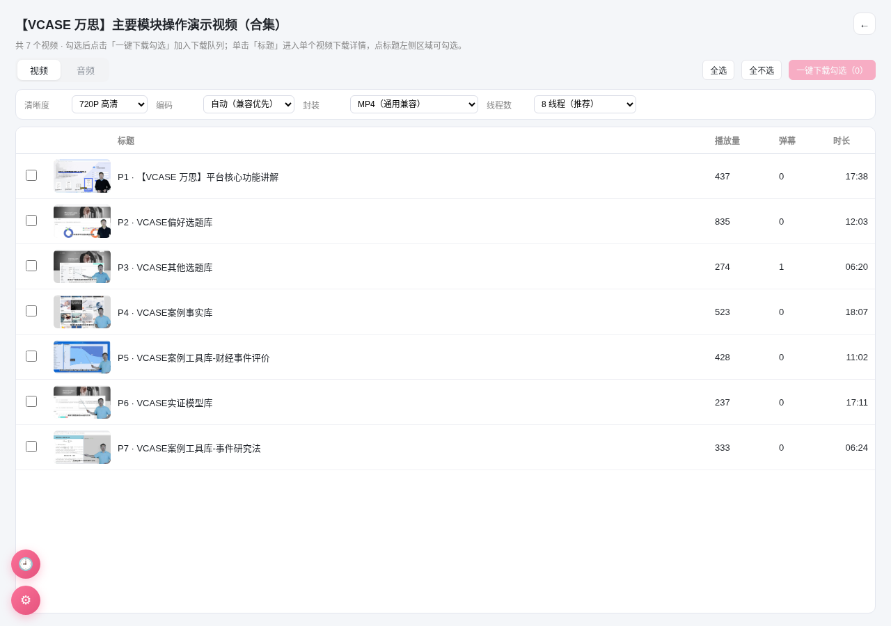

勾选后一键入队，多个任务按并发上限同时下载，其余排队等待；浮层里可暂停或取消单个任务，也能一键中断全部。

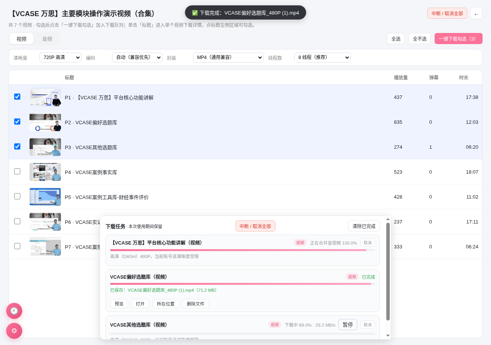

### 番剧

按名称、`ss` / `ep` 编号或番剧页链接搜索，结果只保留番剧内容。

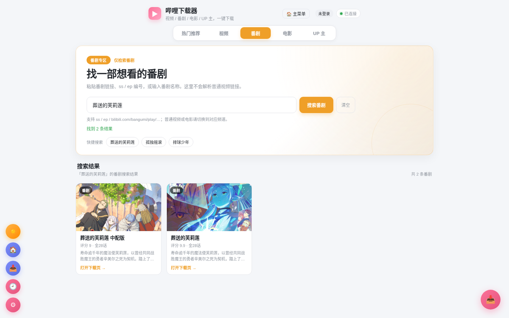

进入番剧下载页后按「正片 / 预告花絮 / 全部」筛选剧集，逐集或下载全部正片；页面底部是番剧专属的下载设置与整季体积预估。

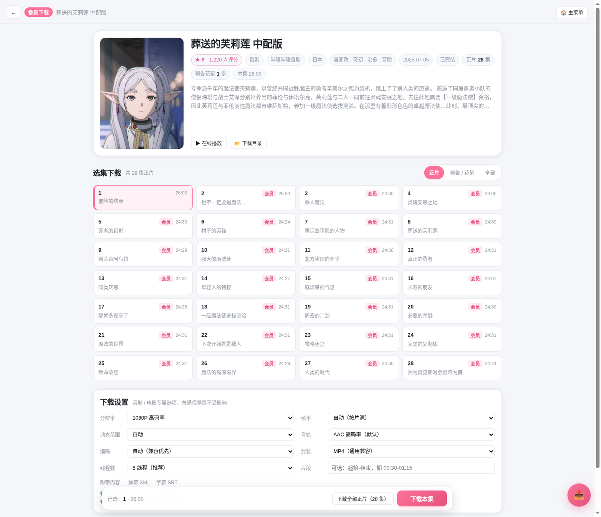

### 电影

与番剧同一套频道结构，只检索电影；付费影片无权限时直接提示，不会把试看片段当成完整影片保存。

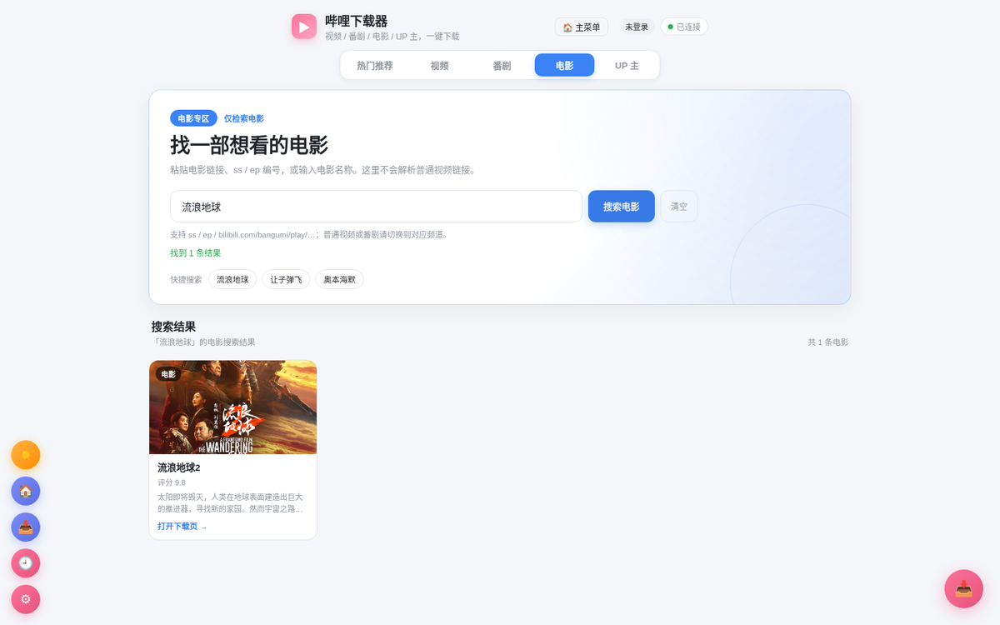

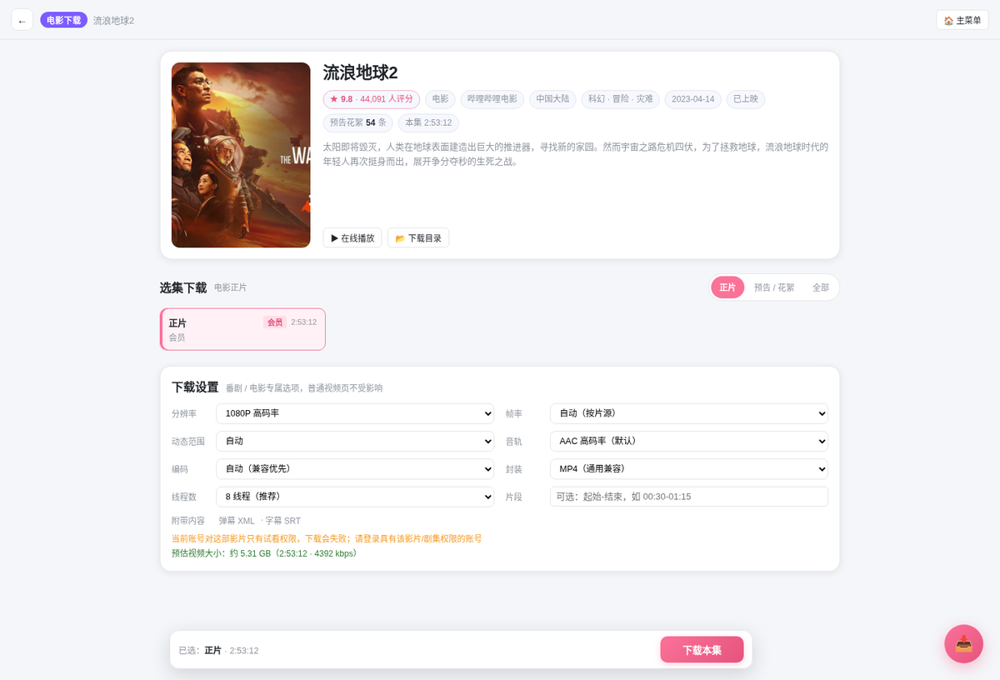

### UP 主

UP 主是独立频道，与番剧、电影平级。支持昵称、UID 与空间链接，结果展示头像、粉丝、投稿数与认证信息。

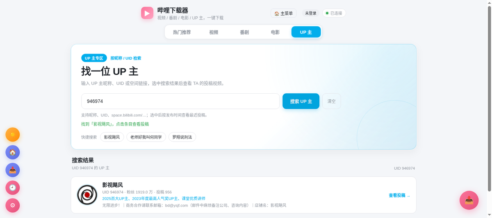

选中「查看投稿」后按发布时间列出该 UP 的全部投稿，每页 50 条并显示总数与页码，可一直翻到最后一页。


### 下载队列

右下角常驻队列入口（可最小化为小球），浮层显示每个任务的进度、速度与状态，支持暂停全部、继续全部、中断 / 取消全部与清除完成。

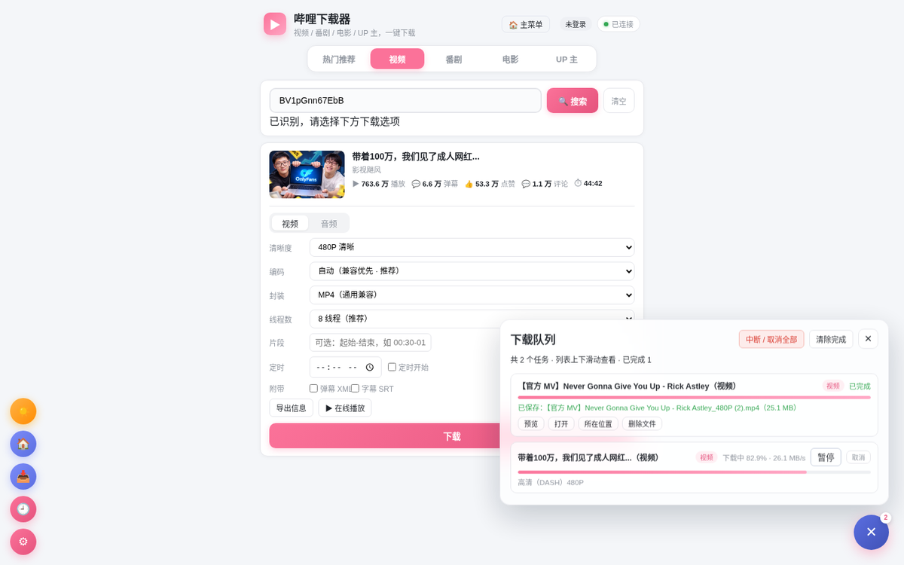

### 下载记录

历史记录持久保存，可打开文件、定位所在目录或删除文件，也能一键清空。

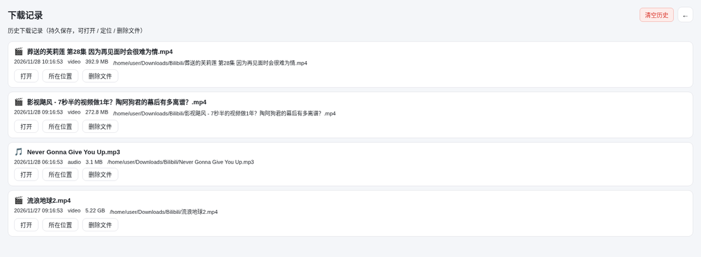

### 设置

设置以侧边抽屉呈现：顶部是界面模式与**默认下载地址**（可直接输入绝对路径、选文件夹或恢复默认，保存时自动建目录并持久化）。

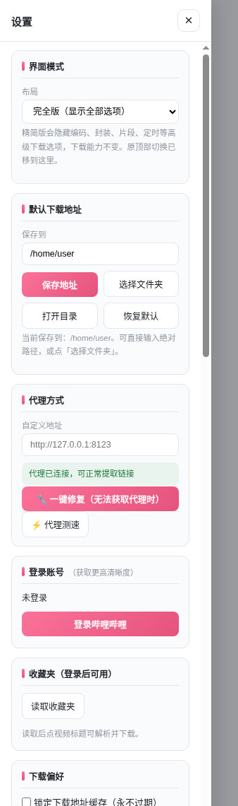

往下是代理方式（自定义地址、一键修复、代理测速）、登录账号、收藏夹、下载偏好（同时下载数上限、搜索每页条数、界面语言、设置导入导出、锁定直链缓存）、下载地址缓存与使用教程。

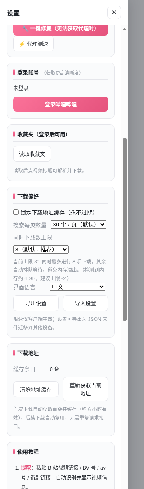

## 功能说明

**内容频道**

- 热门推荐：桌面端独立热门页，卡片点击即播，可在播放栏直接下载本视频。
- 视频：普通视频、分 P、合集、收藏夹、UP 主投稿都能解析；充电专属视频会提示所需权限。
- 番剧 / 电影：`ss` / `ep` / `md` 链接、名称搜索、整季选集、预告花絮筛选；进度按集独立，不会串集。
- UP 主：昵称 / UID / 空间链接搜索 → 查看投稿 → 点投稿直接进「视频」频道下载。

**下载能力**

- 清晰度、编码（H.264 / H.265 / AV1）、封装（MP4 / MKV）、4–16 线程、片段裁剪、定时开始。
- 音视频分离下载 + 内置 FFmpeg 合并；音频可存原版 M4A，或用 MP3 转码（128 / 192 / 320 Kbps）。
- 附带下载字幕 SRT、弹幕 XML；可导出视频信息与封面。
- 暂停 / 继续保留已完成分片；失败或取消后可一键重试，重新获取下载地址并沿用原设置。
- 同名文件自动追加 `(1)`、`(2)`，并发任务不会互相覆盖。

**队列与记录**

- 并发上限默认 8，超限任务显示「等待中」，完成后自动补位；建议上限会按设备内存给出提示。
- 队列浮层可拖动、可最小化为右下角小球，最小化不影响下载。
- 下载记录持久保存，可与任务卡区分：任务卡管理进行中的下载，记录页管理已保存的文件。

**设置与账户**

- 默认下载地址：设置页直接输入 / 选择 / 恢复默认，保存即生效，重启后保留。
- 代理：内置本地代理自动启动，异常时可「一键修复」「代理测速」；也可填自定义代理地址。
- 登录：登录后可获取账号本身有权限的更高清晰度；凭据使用系统加密存储。
- 收藏夹、界面语言、设置导入导出、锁定直链缓存（约 6 小时有效）。

## 平台能力对照

| 能力 | Windows | Android / 浏览器 |
| --- | --- | --- |
| 原版音频、直链视频 | 支持 | 支持 |
| DASH 视频与音轨合并 | 内置 FFmpeg | 原生 MediaMuxer 合并 |
| 暂停 / 继续 | 下载阶段支持 | 尚不支持 |
| MP3 转码 | 支持，转码阶段不支持暂停 | 取决于 Web Audio 能力 |
| Cookie 持久化 | 系统加密存储 | Android Keystore；独立网页代理仅内存 |
| 收藏夹 | 支持（表格列表 + 勾选下载） | 同左 |

**跨重启续传**：Windows 端支持，下载中断后分片保留在本地，重启软件自动恢复并继续下载（设置页可查看续传任务）。合并阶段可以取消，不能暂停；重试会重新开始任务。浏览器 MP3 转码仍会占用较多内存。

功能与视频源、平台及账号权限有关。登录不意味着可以获取账号本身没有权限观看的内容。

> **提示**：固定网络中短时间大量下载可能被哔哩哔哩临时拉黑（表现为只能获取低清晰度、下载速度骤降），可在设置页「网络重置」一键重置，或切换网络后重启软件恢复。

## 本地运行

需要 Node.js **22.12 或更新版本**：

```powershell
npm ci
npm start
```

Windows 启动后粘贴视频链接。桌面端登录位于设置中；原有明文 Cookie 会迁移至加密存储。系统加密服务不可用时，账号只保留在本次进程内，不再写入明文文件。

单独运行网页版：

```powershell
node server.js
```

然后打开 `http://127.0.0.1:8123/`。代理页面会提供本次会话的认证令牌；不要直接双击 `index.html`。独立代理退出后需要重新登录。内置代理端口被其他程序占用时，请关闭冲突的代理实例后在设置中重启代理。

## 构建与测试

```powershell
npm test
npm run assets:android
npm run check
npm run smoke
npm run dist:win          # x64 安装包 + 便携包（Windows 本机构建）
npm run build:win         # 跨平台构建 x64（Linux/macOS 需 wine、makensis、zip）
npm run build:win:32      # 32 位版（Electron 22.3.27 + 32 位 ffmpeg，输出安装包与便携包）
```

`npm run check` 会校验 `app.js` / `index.html` / `styles.css` 与 Android assets 是否同步，改完前端记得先跑 `npm run assets:android`。产物输出到 `dist/`。

FFmpeg 会随依赖安装，并复制到打包后的 `resources/`。其二进制许可证及对应源码信息一并附在 `ffmpeg.LICENSE`、`ffmpeg.README`；项目自身的 MIT 协议不替代第三方组件协议。

## Android 构建

需要 JDK 17 或 21、Android SDK Platform 34 和 Build Tools 34。先同步前端文件：

```powershell
npm run assets:android
$env:JAVA_HOME = '你的 JDK 路径'
$env:ANDROID_HOME = '你的 Android SDK 路径'
cd android
.\gradlew.bat :app:assembleDebug
```

调试 APK：`android/app/build/outputs/apk/debug/app-debug.apk`。Linux / macOS 使用 `bash ./gradlew :app:assembleDebug`。Wrapper 使用 Gradle 8.7，分发包配置了 SHA-256 校验。

发布构建可通过 `BILI_KEYSTORE`、`BILI_STORE_PASSWORD`、`BILI_KEY_ALIAS`、`BILI_KEY_PASSWORD` 提供自己的签名，再运行 `:app:assembleRelease`。未配置时生成未签名的 release APK；仓库不包含签名密钥或密码。

## 代码结构

- `app.js` / `index.html` / `styles.css`：共用前端（五个频道、详情页、队列、设置）。
- `main.js` / `preload.js`：Electron 生命周期、IPC 和文件权限。
- `server.js`：带鉴权的本地代理、WBI 签名、设备身份与 412 重试。
- `lib/downloader.js`：分片下载、校验、重试、暂停 / 取消与连接池。
- `lib/security.js` / `lib/cookie-store.js`：地址、文件和凭据边界。
- `android/`：Android 工程；assets 由 `npm run assets:android` 同步。
- `tests/` / `scripts/smoke.cjs`：核心与界面回归验证。
- `bilibili-downloader.user.js`：油猴脚本（浏览器直用版）。
- `docs/screenshots/`：README 使用的界面截图。

## 版本历史

- **v1.8.17**：修复 UP 主投稿列表不完整：投稿接口改为 WBI 签名并补上 B 站新版 `dm_img` 风控参数，每页从 20 条提升到 50 条；分页显示总投稿数、当前页与每页条数，支持连续翻页查看全部投稿，并加入 1.6 秒请求间隔避免翻页触发风控。
- **v1.8.16**：修复 UP 主页面 UI 缩放：桌面宽屏改为与番剧 / 电影一致的 1040px 宽版，1180px 以下自动预留左右操作栏安全边距，760px 以下收窄头像与卡片内边距，避免左侧记录 / 设置栏压住内容。
- **v1.8.15**：UP 主改为顶层独立频道，与番剧 / 电影平级，不再嵌入番剧 / 电影搜索页；支持按昵称、UID、`space.bilibili.com/…` 搜索 UP 主，选中后查看其投稿视频，点击投稿自动切到「视频」频道下载；设置页新增可直接输入 / 选择 / 恢复默认的「默认下载地址」，保存时自动建目录并持久化。撤销 v1.8.14 的嵌入式入口。
- **v1.8.13**：番剧 / 分P批量下载重做文件命名：番剧按「番剧名 第n集 本集名」落盘，自动去掉季度标题里的「（N 集）」与剧集名外层括号；视频批量只保留本视频 / 分P名称，不再拼接父标题、`[P 序号]` 或 `[集名]` 标签。批量列表行名与最终文件名保持一致。
- **v1.8.12**：在线播放 / 热门播放的代理流失败转直链后，直链再失败会继续执行 MP4 → DASH 降级，不再停在黑屏；新增播放请求令牌，切换视频、关闭播放器或解析新链接后，迟到的取流 / 鉴权 / DASH 音频不再覆盖播放器或后台开声；离开热门频道与关闭热门播放栏会清空视频地址并作废旧请求；批量任务进行中再次打开批量面板不再重置选中状态；预告 / 花絮缺失时长时回退影片时长，不再串用正片时长。
- **v1.8.11**：热门内嵌播放器切到视频 / 番剧 / 电影频道时自动暂停，不再后台残留音频；切换清晰度会作废旧播放地址请求；批量下载在「获取视频信息」阶段取消全部后，迟到请求不再拉起新任务，并避免误报批量完成；预告 / 花絮预估体积改按 extras 索引取时长，不再串到正片时长。
- **v1.8.10**：批量下载支持逐集勾选 / 全选与「下载全部」；修复「中断 / 取消全部」后排队任务仍被调度器拉起；热门推荐改为点击即播，播放器下方直接提供下载选项与预估大小，并优化四列网格布局与 `[object Object]` 统计；番剧 / 电影下载设置下方新增视频 / 音频预估体积；修正付费影片被误报「需要大会员」；统一下载选项控件高度；精简版改为 `body.ui-lite` 强制隐藏，修复切频道 / 音视频后被 `hidden` 覆盖失效。
- **v1.8.9**：番剧「下载全部正片」改为全部剧集一次性并发入队，修复只启动第 1 集、其余 27 集一直等待的问题；每集独立快照，保留各自 ep_id / cid；新增多线程 Range 并发回归测试，确认 8 / 16 线程确实同时发起分片请求；番剧底部操作栏缩窄并为右下角队列球让位，修复「下载本集」被遮挡；下载队列浮层改为毛玻璃虚化。
- **Android 1.3.3（真机下载修复）**：补齐原生 DASH 双轨下载与 MediaMuxer 合并；playurl 与 CDN 请求改用真实视频页 Referer 并在 412 时退避换身份重试；高清合并失败或无音频轨时自动回退兼容 MP4 直链；空文件 / HTML 错误页不再伪装成视频；文件打开、目录、删除兼容同步桥；MP3 分段保存按任务隔离，禁止 Cookie 注入控制字符。
- **v1.8.8**：番剧 / 电影独立下载页，支持 4K / 真彩 HDR / 60 帧、音轨、编码、封装、片段与预告筛选；Android 端 PGC 页收敛到 720P 直链并修复启动阻断；媒体 Cookie 收紧到官方域名、重复代码清理 5,511 行。
- **v1.8.7**：无系统密钥环时登录凭据改为 0600 明文保留（重启仍登录），磁盘预检按 CDN 备选取最大值，修掉大文件误报空间不足。
- **v1.8.6**：DASH 合流改为按码率取最高音频档，修掉所有视频音轨只有 64k 的问题。
- **v1.8.5**：切换剧集/分 P 时同步更新时长并清空片段区间；未开播季度回落到预告列表而不是报错。
- **v1.8.4**：支持 `/bangumi/media/md…` 媒体页（media → season 两级解析）；单集电影不再显示「下载全部」；油猴脚本同步支持 md 页。
- **v1.8.3**：油猴脚本普通视频页不再误判成番剧、支持 `ss` 页；试看权限在解析阶段即提示；切换视频不再残留旧提示；电影信息补充上映日期。
- **v1.8.2**：电影（PGC type=2）可读取片名 / UP / 时长并保存；大会员电影在无权限账号下只返回试看片段，现在直接拒绝而不是把 6 分钟片段当完整影片保存；UP 名兼容 `up_info.uname`。
- **v1.8.1**：番剧时长按毫秒换算修正、「正片 / PV」不再拼成「第正片话」、`ep` 指向 PV/花絮时不再回落到第 1 集、番剧字幕补 `ep_id`；油猴脚本支持番剧页下载。
- **v1.8.0**：番剧 / 影视（PGC）真支持——改用 `pgc/view/web/season` 解析、`pgc/player/web/playurl` 取流，`ep` 链接直接定位到对应剧集；充电专属视频给出充电与权限提示。
- **v1.7.9**：油猴脚本对多段 `durl` 视频改为逐段下载（此前只下第一段，成品被截断且无提示）；代理 `/api` 的 Content-Type 不再重复拼接 `charset`。
- **v1.7.8**：自动更新面板资源过滤改为按扩展名匹配；Android URL 策略与桌面端对齐，修复部分 CDN 直链下载失败。
- **v1.7.7**：安全加固（代理端口策略、网站端授权绑定来源与 CSRF 防护、`Origin: null` 领取面、续传目录白名单、Cookie 文件权限）、跨重启续传修复、油猴脚本无声视频修复、并发预检与单分片快速落盘、打包架构修复并补齐 32 位产物。
- **v1.7.6**：网站端代理配对与 token 失效自愈、Android 原生取消下载等迭代。
- **v1.6.0**：修复批量列表封面（统一 https，兼容协议相对链接）；下载任务悬浮窗可拖动 + 左上角 × 最小化为小球；左下新增下载队列页（实时任务状态 + 回退）；左下新增主菜单一键返回（保留下载任务）。
- **v1.5.0**：软件内搜索（WBI 签名 + 代理优先）、跨重启断点续传、自动更新检查、快捷键（Ctrl+D / 全局粘贴）、主题跟随系统、Android 原生 DASH 高清合并（MediaMuxer，无需 FFmpeg）。
- **v1.4.2**：列表点击判定收窄——仅点击「标题」进入单个视频详情；标题左侧（封面 / 勾选列）点击判定为勾选该项。
- **v1.4.1**：合集 / 收藏夹列表面板补齐完整下载选项（清晰度、编码、封装、音频格式、线程数），一键下载勾选使用列表所选设置。
- **v1.4.0**：合集 / 收藏夹表格列表（勾选 + 全选 / 全不选 + 单击进详情）、并发下载调度（上限 + 内存建议 + 等待补位）、一键取消全部、返回主菜单、简易模式恢复视频详情。
- **v1.3.x**：合集 / 收藏夹批量下载、编码选择、多线程并发提速、下载历史、设置模块等。

更详细的变更见 [ROADMAP.md](ROADMAP.md) 与 [Releases](https://github.com/GenshinplayerDom/bilibili-downloader/releases)。

## License

[MIT](LICENSE) © GenshinplayerDom。请保留原作者署名与许可证。
